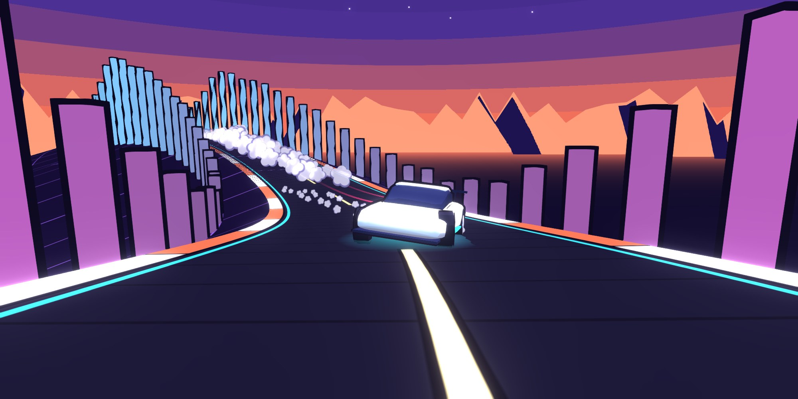
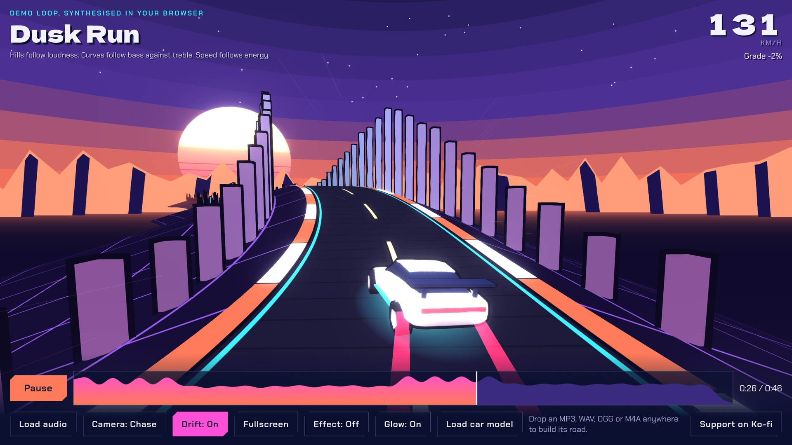
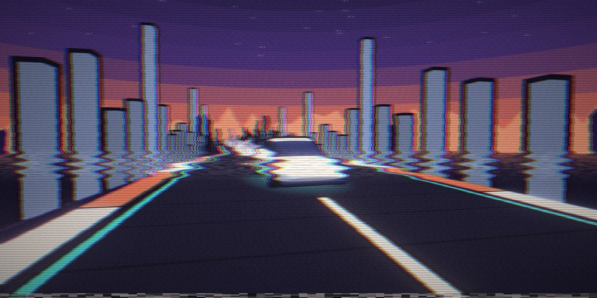
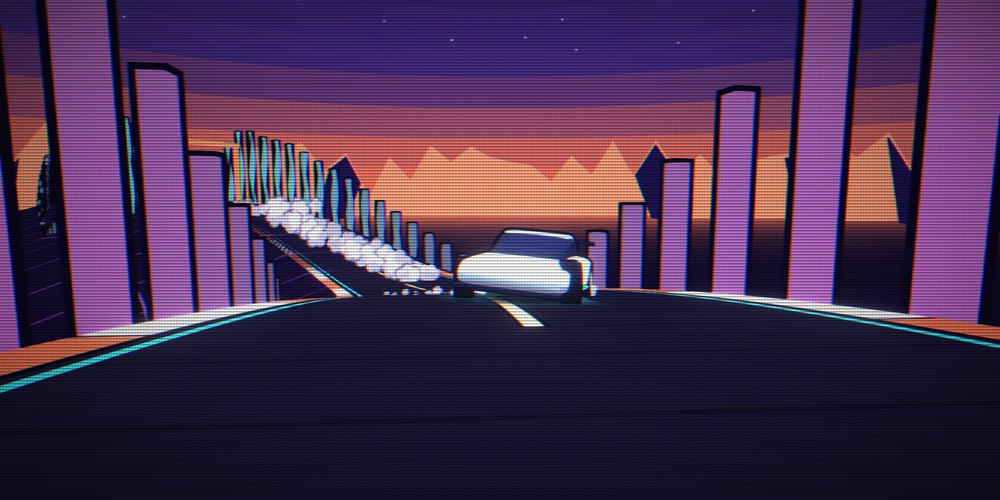
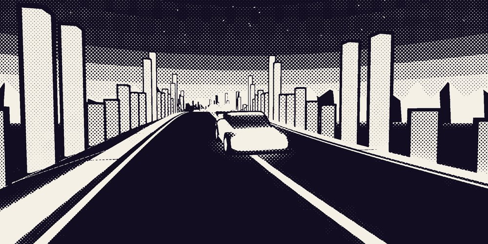
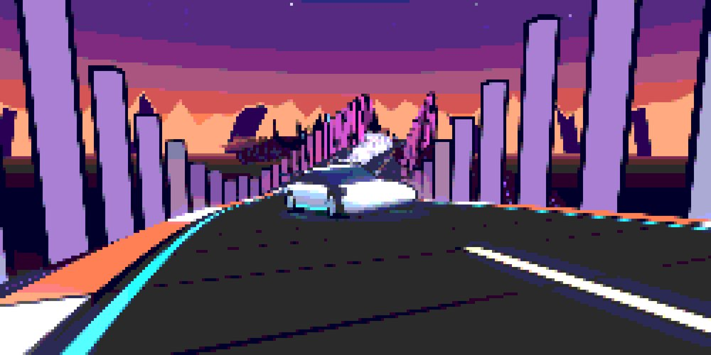
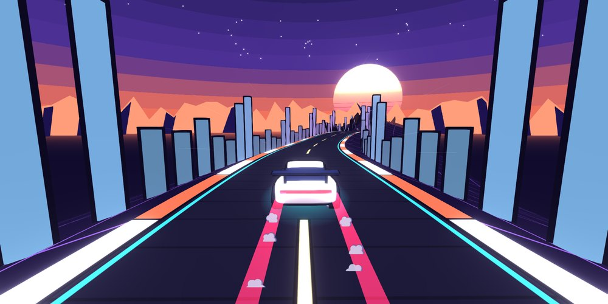
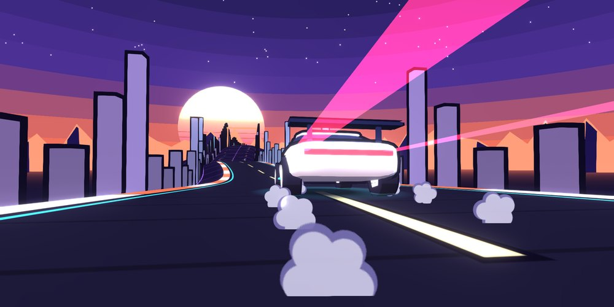
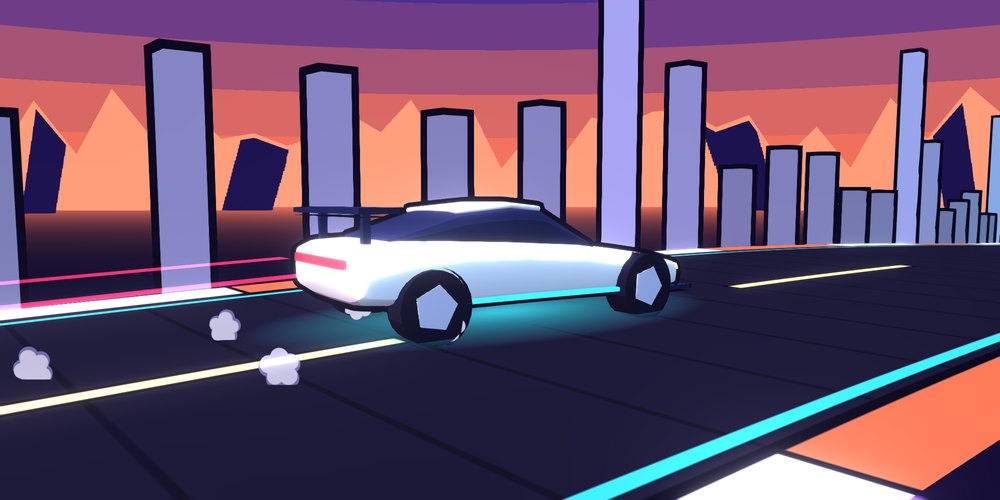
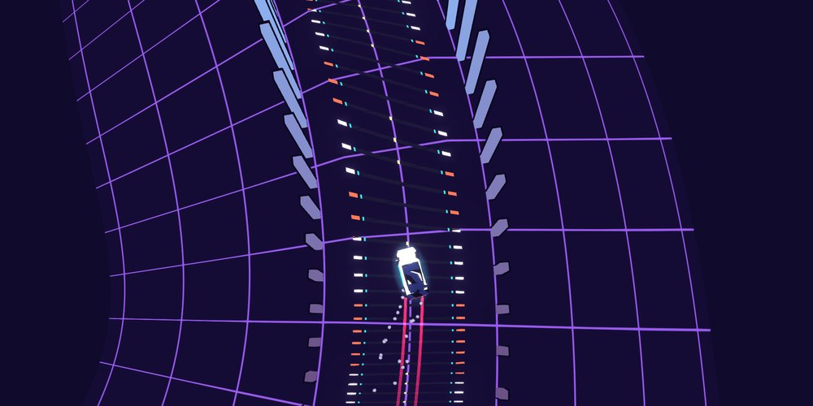

# Waveform Touge

**Your track is the road.** 
An audio-driven anime night drive that runs in the browser.

---

A track's loudness and tone become the road a cel-shaded car drifts down, with cinematic cameras and VHS-style effects. It opens on a demo loop synthesised in the browser, so there is a road the moment the page loads.

## The player

Song title and live speed up top; play, seek and the camera, drift and effect buttons along the bottom. The controls fade away after a few seconds of playback so the drive fills the screen.

## How the audio becomes the road

| In the music | On the road |
|---|---|
| Loudness, smoothed | **Hills.** Quiet passages are valleys, loud ones are peaks. |
| Bass against treble | **Curves.** The balance steers the road left and right. |
| Energy | **Speed.** The car covers more road in the big sections. |
| Loudness, frame by frame | **Skyline.** The bars lining both sides of the road. |
| The hardest hits | **Neon gates** to drive through. |

## Effects

<table>
  <tr>
    <td width="50%"> 
<b>VHS</b>
</td>
    <td width="50%"> 
<b>CRT</b>
</td>
  </tr>
  <tr>
    <td> 
<b>Manga</b>
</td>
    <td> 
<b>Pixel</b>
</td>
  </tr>
</table>

## Cameras

Ten angles, plus a **Cinematic** mode that cuts between them on strong bass hits.

<table>
  <tr>
    <td width="50%"> 
<b>Chase</b>
</td>
    <td width="50%"> 
<b>Low rear</b>
</td>
  </tr>
  <tr>
    <td> 
<b>Trackside</b>
</td>
    <td> 
<b>Heli</b>
</td>
  </tr>
</table>

Also: Low side, High, Bumper, Wheel, Front and Orbit.

## Drift

Three modes: **Off**, **On**, and **Auto**. Auto decides corner by corner whether to slide, and whether to link into the next corner or straighten up. Drifting counter-steers the front wheels and throws cel-shaded tyre smoke.

## Controls

| Key | Action |
|---|---|
| `Space` | Play / pause |
| `C` | Next camera |
| `V` | Next effect |
| `D` (hold) | Drift |
| `F` | Fullscreen |
| `←` `→` on the seek bar | Skip 5 seconds |

The seek bar is the road's elevation profile, so you can see the drops coming.

## Running it

It is a single `index.html` with no build step. Use the link above, or serve the folder with any static file server. Three.js r128 loads from a CDN, so it needs a network connection.

## Support

If you enjoy this, you can support the work on Ko-fi: **https://ko-fi.com/nytmaer**

## License

[MIT](LICENSE)
